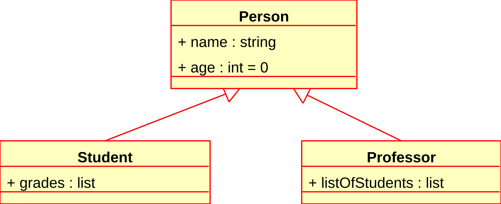

# Tutorial de ejemplo



## Paso 1: Hola Mundo

```java
void main() {
    IO.println("Hola, Guali con Java 25!");
}
```

1. En base al código en pantalla, crea una versión que imprima primero "Hola" y luego en una nueva línea "Guali con Java 25!"
2. Recuerde que el código debe de compilar correctamente
3. El botón Ejecutar validará su resultado

## Paso 2: Hola Mundo Java < 25
Antes de Java 25, el método principal de una clase tenía la siguiente sintáxis:

```java
public static void main(String args[]){
    //tu codigo fuente
}
```

1. Prueba rescribir totalmente tu codigo actual para que sea compatible con Java < 25
2. Recuerde que el código debe de compilar correctamente
3. El botón Ejecutar validará su resultado

> **Nota:** `IO.println` solo está disponible a partir de Java 25 (ver [JEP 512](https://openjdk.org/jeps/512)).

| Versión de Java | Firma del método `main` |
| --- | --- |
| Java 25+ | `void main()` |
| Java < 25 | `public static void main(String[] args)` |
